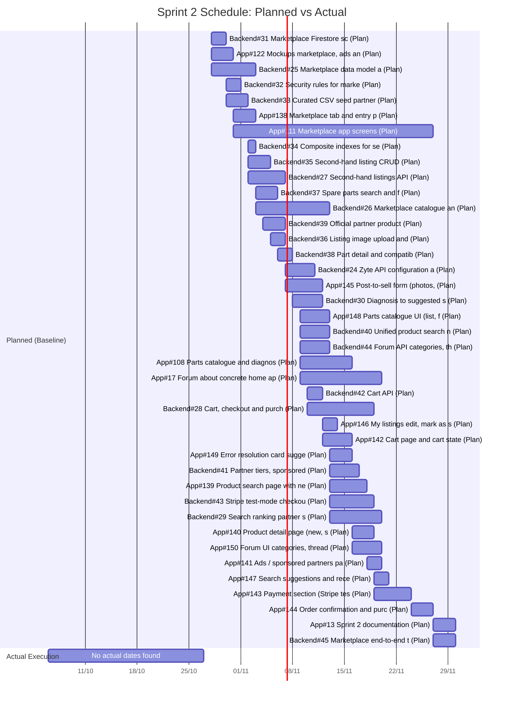
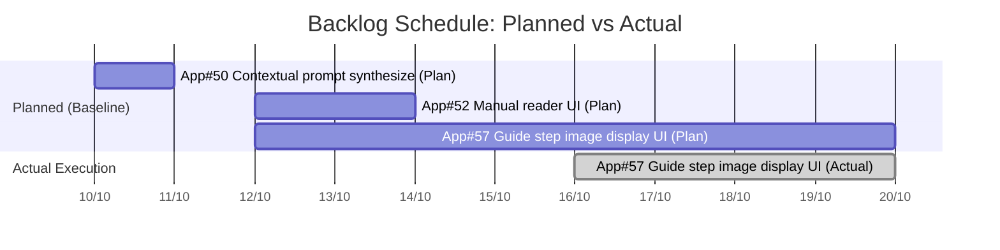

# Project Gantt Comparison

Automated schedule comparison generated from the **HoDoWo** GitHub Project.

## Overall Schedule Comparison (By Sprint)

```mermaid
gantt
    title Project Schedule Comparison: Planned vs Actual
    dateFormat  YYYY-MM-DD
    axisFormat  %b %d

    section Sprint 1 - Planned
    App#38 Camera capture with CameraX (Plan) :p_app_38, 2026-10-05, 2026-10-09
    App#47 CI with GitHub Actions (Plan) :p_app_47, 2026-10-06, 2026-10-07
    App#43 Set up LangChain Agent (Plan) :p_app_43, 2026-10-06, 2026-10-08
    App#64 Chat UI (text and images) (Plan) :p_app_64, 2026-10-06, 2026-10-09
    App#41 Vision LLM pipeline detect b (Plan) :p_app_41, 2026-10-06, 2026-10-10
    App#36 Set up SonarQube (Plan) :p_app_36, 2026-10-06, 2026-10-12
    App#46 Repo structure, README and b (Plan) :p_app_46, 2026-10-06, 2026-10-12
    App#49 Walking skeleton Android → F (Plan) :p_app_49, 2026-10-06, 2026-10-12
    App#48 FastAPI on Vercel CORS, rate (Plan) :p_app_48, 2026-10-06, 2026-10-18
    App#61 Button and dial detection (Plan) :p_app_61, 2026-10-06, 2026-10-18
    App#87 Working on fixing issues on (Plan) :p_app_87, 2026-10-06, 2026-10-27
    App#42 Identification result card w (Plan) :p_app_42, 2026-10-07, 2026-10-10
    App#4 Appliance Identification (Plan) :p_app_4, 2026-10-09, 2026-10-21
    App#5 Manual retrieval (Plan) :p_app_5, 2026-10-10, 2026-10-12
    App#53 Firebase project + Auth SDK (Plan) :p_app_53, 2026-10-11, 2026-10-13
    App#54 Login, register and Google s (Plan) :p_app_54, 2026-10-11, 2026-10-17
    App#66 Conversational route history (Plan) :p_app_66, 2026-10-11, 2026-10-19
    App#63 Chat and Q&A (Plan) :p_app_63, 2026-10-11, 2026-10-22
    App#37 Implement Favourites and Rec (Plan) :p_app_37, 2026-10-11, 2026-10-26
    App#55 JWT interceptor + token chec (Plan) :p_app_55, 2026-10-12, 2026-10-13
    App#10 Image Overlay Guide generati (Plan) :p_app_10, 2026-10-12, 2026-10-16
    App#72 Fix SonarQube issues (Plan) :p_app_72, 2026-10-13, 2026-10-14
    App#40 Reinforcement AI learning (Plan) :p_app_40, 2026-10-13, 2026-10-16
    App#39 Upload image to Firebase Sto (Plan) :p_app_39, 2026-10-14, 2026-10-16
    App#65 Error codes (Plan) :p_app_65, 2026-10-14, 2026-10-23
    App#83 Prepare UI to receive SSE (Plan) :p_app_83, 2026-10-15, 2026-10-17
    App#99 Kotlin App Tests (Plan) :p_app_99, 2026-10-15, 2026-10-20
    App#62 Sprint 1 clickable prototype (Plan) :p_app_62, 2026-10-15, 2026-10-29
    App#44 Configure OWASP ZAP (Plan) :p_app_44, 2026-10-17, 2026-10-18
    App#95 Implement bookmark manuals (Plan) :p_app_95, 2026-10-17, 2026-10-18
    App#12 Create Project Documentation (Plan) :p_app_12, 2026-10-20, 2026-10-27
    App#71 Plan Sprint 2 (Plan) :p_app_71, 2026-10-25, 2026-10-28
    section Sprint 1 - Actual
    App#47 CI with GitHub Actions (Actual) :done, a_app_47, 2026-10-06, 2026-10-07
    App#38 Camera capture with CameraX (Actual) :done, a_app_38, 2026-10-06, 2026-10-10
    App#64 Chat UI (text and images) (Actual) :done, a_app_64, 2026-10-07, 2026-10-09
    App#41 Vision LLM pipeline detect b (Actual) :done, a_app_41, 2026-10-07, 2026-10-10
    App#43 Set up LangChain Agent (Actual) :done, a_app_43, 2026-10-08, 2026-10-10
    App#4 Appliance Identification (Actual) :done, a_app_4, 2026-10-09, 2026-10-20
    App#42 Identification result card w (Actual) :done, a_app_42, 2026-10-10, 2026-10-11
    App#5 Manual retrieval (Actual) :done, a_app_5, 2026-10-10, 2026-10-12
    App#36 Set up SonarQube (Actual) :done, a_app_36, 2026-10-11, 2026-10-12
    App#46 Repo structure, README and b (Actual) :done, a_app_46, 2026-10-11, 2026-10-12
    App#49 Walking skeleton Android → F (Actual) :done, a_app_49, 2026-10-11, 2026-10-12
    App#54 Login, register and Google s (Actual) :done, a_app_54, 2026-10-11, 2026-10-21
    App#37 Implement Favourites and Rec (Actual) :done, a_app_37, 2026-10-11, 2026-10-26
    App#55 JWT interceptor + token chec (Actual) :done, a_app_55, 2026-10-12, 2026-10-13
    App#63 Chat and Q&A (Actual) :done, a_app_63, 2026-10-12, 2026-10-20
    App#53 Firebase project + Auth SDK (Actual) :done, a_app_53, 2026-10-13, 2026-10-14
    App#72 Fix SonarQube issues (Actual) :done, a_app_72, 2026-10-13, 2026-10-14
    App#66 Conversational route history (Actual) :done, a_app_66, 2026-10-13, 2026-10-17
    App#99 Kotlin App Tests (Actual) :done, a_app_99, 2026-10-13, 2026-10-21
    App#48 FastAPI on Vercel CORS, rate (Actual) :done, a_app_48, 2026-10-15, 2026-10-16
    App#61 Button and dial detection (Actual) :done, a_app_61, 2026-10-15, 2026-10-16
    App#83 Prepare UI to receive SSE (Actual) :done, a_app_83, 2026-10-15, 2026-10-16
    App#10 Image Overlay Guide generati (Actual) :done, a_app_10, 2026-10-15, 2026-10-17
    App#44 Configure OWASP ZAP (Actual) :done, a_app_44, 2026-10-16, 2026-10-17
    App#62 Sprint 1 clickable prototype (Actual) :done, a_app_62, 2026-10-16, 2026-10-17
    App#95 Implement bookmark manuals (Actual) :done, a_app_95, 2026-10-17, 2026-10-18
    App#39 Upload image to Firebase Sto (Actual) :done, a_app_39, 2026-10-18, 2026-10-20
    App#40 Reinforcement AI learning (Actual) :done, a_app_40, 2026-10-18, 2026-10-20
    App#65 Error codes (Actual) :done, a_app_65, 2026-10-18, 2026-10-21

    section Sprint 2 - Planned
    Backend#31 Marketplace Firestore sc (Plan) :p_backend_31, 2026-10-28, 2026-10-30
    App#122 Mockups marketplace, ads an (Plan) :p_app_122, 2026-10-28, 2026-10-31
    Backend#25 Marketplace data model a (Plan) :p_backend_25, 2026-10-28, 2026-11-03
    Backend#32 Security rules for marke (Plan) :p_backend_32, 2026-10-30, 2026-11-01
    Backend#33 Curated CSV seed partner (Plan) :p_backend_33, 2026-10-30, 2026-11-02
    App#138 Marketplace tab and entry p (Plan) :p_app_138, 2026-10-31, 2026-11-03
    App#111 Marketplace app screens (Plan) :p_app_111, 2026-10-31, 2026-11-27
    Backend#34 Composite indexes for se (Plan) :p_backend_34, 2026-11-02, 2026-11-03
    Backend#35 Second-hand listing CRUD (Plan) :p_backend_35, 2026-11-02, 2026-11-05
    Backend#27 Second-hand listings API (Plan) :p_backend_27, 2026-11-02, 2026-11-07
    Backend#37 Spare parts search and f (Plan) :p_backend_37, 2026-11-03, 2026-11-06
    Backend#26 Marketplace catalogue an (Plan) :p_backend_26, 2026-11-03, 2026-11-13
    Backend#39 Official partner product (Plan) :p_backend_39, 2026-11-04, 2026-11-07
    Backend#36 Listing image upload and (Plan) :p_backend_36, 2026-11-05, 2026-11-07
    Backend#38 Part detail and compatib (Plan) :p_backend_38, 2026-11-06, 2026-11-08
    Backend#24 Zyte API configuration a (Plan) :p_backend_24, 2026-11-07, 2026-11-11
    App#145 Post-to-sell form (photos, (Plan) :p_app_145, 2026-11-07, 2026-11-12
    Backend#30 Diagnosis to suggested s (Plan) :p_backend_30, 2026-11-08, 2026-11-12
    App#148 Parts catalogue UI (list, f (Plan) :p_app_148, 2026-11-09, 2026-11-13
    Backend#40 Unified product search n (Plan) :p_backend_40, 2026-11-09, 2026-11-13
    Backend#44 Forum API categories, th (Plan) :p_backend_44, 2026-11-09, 2026-11-13
    App#108 Parts catalogue and diagnos (Plan) :p_app_108, 2026-11-09, 2026-11-16
    App#17 Forum about concrete home ap (Plan) :p_app_17, 2026-11-09, 2026-11-20
    Backend#42 Cart API (Plan) :p_backend_42, 2026-11-10, 2026-11-12
    Backend#28 Cart, checkout and purch (Plan) :p_backend_28, 2026-11-10, 2026-11-19
    App#146 My listings edit, mark as s (Plan) :p_app_146, 2026-11-12, 2026-11-14
    App#142 Cart page and cart state (Plan) :p_app_142, 2026-11-12, 2026-11-16
    App#149 Error resolution card sugge (Plan) :p_app_149, 2026-11-13, 2026-11-16
    Backend#41 Partner tiers, sponsored (Plan) :p_backend_41, 2026-11-13, 2026-11-17
    App#139 Product search page with ne (Plan) :p_app_139, 2026-11-13, 2026-11-18
    Backend#43 Stripe test-mode checkou (Plan) :p_backend_43, 2026-11-13, 2026-11-19
    Backend#29 Search ranking partner s (Plan) :p_backend_29, 2026-11-13, 2026-11-20
    App#140 Product detail page (new, s (Plan) :p_app_140, 2026-11-16, 2026-11-19
    App#150 Forum UI categories, thread (Plan) :p_app_150, 2026-11-16, 2026-11-20
    App#141 Ads / sponsored partners pa (Plan) :p_app_141, 2026-11-18, 2026-11-20
    App#147 Search suggestions and rece (Plan) :p_app_147, 2026-11-19, 2026-11-21
    App#143 Payment section (Stripe tes (Plan) :p_app_143, 2026-11-19, 2026-11-24
    App#144 Order confirmation and purc (Plan) :p_app_144, 2026-11-24, 2026-11-27
    App#13 Sprint 2 documentation (Plan) :p_app_13, 2026-11-27, 2026-11-30
    Backend#45 Marketplace end-to-end t (Plan) :p_backend_45, 2026-11-27, 2026-11-30

    section Backlog - Planned
    App#50 Contextual prompt synthesize (Plan) :p_app_50, 2026-10-10, 2026-10-11
    App#52 Manual reader UI (Plan) :p_app_52, 2026-10-12, 2026-10-14
    App#57 Guide step image display UI (Plan) :p_app_57, 2026-10-12, 2026-10-20
    section Backlog - Actual
    App#57 Guide step image display UI (Actual) :done, a_app_57, 2026-10-16, 2026-10-20

```

## Sprint 1 Detail (Planned vs Actual)

```mermaid
gantt
    title Sprint 1 Schedule: Planned vs Actual
    dateFormat  YYYY-MM-DD
    axisFormat  %d/%m

    section Planned (Baseline)
    App#38 Camera capture with CameraX (Plan) :p_app_38, 2026-10-05, 2026-10-09
    App#47 CI with GitHub Actions (Plan) :p_app_47, 2026-10-06, 2026-10-07
    App#43 Set up LangChain Agent (Plan) :p_app_43, 2026-10-06, 2026-10-08
    App#64 Chat UI (text and images) (Plan) :p_app_64, 2026-10-06, 2026-10-09
    App#41 Vision LLM pipeline detect b (Plan) :p_app_41, 2026-10-06, 2026-10-10
    App#36 Set up SonarQube (Plan) :p_app_36, 2026-10-06, 2026-10-12
    App#46 Repo structure, README and b (Plan) :p_app_46, 2026-10-06, 2026-10-12
    App#49 Walking skeleton Android → F (Plan) :p_app_49, 2026-10-06, 2026-10-12
    App#48 FastAPI on Vercel CORS, rate (Plan) :p_app_48, 2026-10-06, 2026-10-18
    App#61 Button and dial detection (Plan) :p_app_61, 2026-10-06, 2026-10-18
    App#87 Working on fixing issues on (Plan) :p_app_87, 2026-10-06, 2026-10-27
    App#42 Identification result card w (Plan) :p_app_42, 2026-10-07, 2026-10-10
    App#4 Appliance Identification (Plan) :p_app_4, 2026-10-09, 2026-10-21
    App#5 Manual retrieval (Plan) :p_app_5, 2026-10-10, 2026-10-12
    App#53 Firebase project + Auth SDK (Plan) :p_app_53, 2026-10-11, 2026-10-13
    App#54 Login, register and Google s (Plan) :p_app_54, 2026-10-11, 2026-10-17
    App#66 Conversational route history (Plan) :p_app_66, 2026-10-11, 2026-10-19
    App#63 Chat and Q&A (Plan) :p_app_63, 2026-10-11, 2026-10-22
    App#37 Implement Favourites and Rec (Plan) :p_app_37, 2026-10-11, 2026-10-26
    App#55 JWT interceptor + token chec (Plan) :p_app_55, 2026-10-12, 2026-10-13
    App#10 Image Overlay Guide generati (Plan) :p_app_10, 2026-10-12, 2026-10-16
    App#72 Fix SonarQube issues (Plan) :p_app_72, 2026-10-13, 2026-10-14
    App#40 Reinforcement AI learning (Plan) :p_app_40, 2026-10-13, 2026-10-16
    App#39 Upload image to Firebase Sto (Plan) :p_app_39, 2026-10-14, 2026-10-16
    App#65 Error codes (Plan) :p_app_65, 2026-10-14, 2026-10-23
    App#83 Prepare UI to receive SSE (Plan) :p_app_83, 2026-10-15, 2026-10-17
    App#99 Kotlin App Tests (Plan) :p_app_99, 2026-10-15, 2026-10-20
    App#62 Sprint 1 clickable prototype (Plan) :p_app_62, 2026-10-15, 2026-10-29
    App#44 Configure OWASP ZAP (Plan) :p_app_44, 2026-10-17, 2026-10-18
    App#95 Implement bookmark manuals (Plan) :p_app_95, 2026-10-17, 2026-10-18
    App#12 Create Project Documentation (Plan) :p_app_12, 2026-10-20, 2026-10-27
    App#71 Plan Sprint 2 (Plan) :p_app_71, 2026-10-25, 2026-10-28

    section Actual Execution
    App#47 CI with GitHub Actions (Actual) :done, a_app_47, 2026-10-06, 2026-10-07
    App#38 Camera capture with CameraX (Actual) :done, a_app_38, 2026-10-06, 2026-10-10
    App#64 Chat UI (text and images) (Actual) :done, a_app_64, 2026-10-07, 2026-10-09
    App#41 Vision LLM pipeline detect b (Actual) :done, a_app_41, 2026-10-07, 2026-10-10
    App#43 Set up LangChain Agent (Actual) :done, a_app_43, 2026-10-08, 2026-10-10
    App#4 Appliance Identification (Actual) :done, a_app_4, 2026-10-09, 2026-10-20
    App#42 Identification result card w (Actual) :done, a_app_42, 2026-10-10, 2026-10-11
    App#5 Manual retrieval (Actual) :done, a_app_5, 2026-10-10, 2026-10-12
    App#36 Set up SonarQube (Actual) :done, a_app_36, 2026-10-11, 2026-10-12
    App#46 Repo structure, README and b (Actual) :done, a_app_46, 2026-10-11, 2026-10-12
    App#49 Walking skeleton Android → F (Actual) :done, a_app_49, 2026-10-11, 2026-10-12
    App#54 Login, register and Google s (Actual) :done, a_app_54, 2026-10-11, 2026-10-21
    App#37 Implement Favourites and Rec (Actual) :done, a_app_37, 2026-10-11, 2026-10-26
    App#55 JWT interceptor + token chec (Actual) :done, a_app_55, 2026-10-12, 2026-10-13
    App#63 Chat and Q&A (Actual) :done, a_app_63, 2026-10-12, 2026-10-20
    App#53 Firebase project + Auth SDK (Actual) :done, a_app_53, 2026-10-13, 2026-10-14
    App#72 Fix SonarQube issues (Actual) :done, a_app_72, 2026-10-13, 2026-10-14
    App#66 Conversational route history (Actual) :done, a_app_66, 2026-10-13, 2026-10-17
    App#99 Kotlin App Tests (Actual) :done, a_app_99, 2026-10-13, 2026-10-21
    App#48 FastAPI on Vercel CORS, rate (Actual) :done, a_app_48, 2026-10-15, 2026-10-16
    App#61 Button and dial detection (Actual) :done, a_app_61, 2026-10-15, 2026-10-16
    App#83 Prepare UI to receive SSE (Actual) :done, a_app_83, 2026-10-15, 2026-10-16
    App#10 Image Overlay Guide generati (Actual) :done, a_app_10, 2026-10-15, 2026-10-17
    App#44 Configure OWASP ZAP (Actual) :done, a_app_44, 2026-10-16, 2026-10-17
    App#62 Sprint 1 clickable prototype (Actual) :done, a_app_62, 2026-10-16, 2026-10-17
    App#95 Implement bookmark manuals (Actual) :done, a_app_95, 2026-10-17, 2026-10-18
    App#39 Upload image to Firebase Sto (Actual) :done, a_app_39, 2026-10-18, 2026-10-20
    App#40 Reinforcement AI learning (Actual) :done, a_app_40, 2026-10-18, 2026-10-20
    App#65 Error codes (Actual) :done, a_app_65, 2026-10-18, 2026-10-21
```

## Sprint 2 Detail (Planned vs Actual)

## Backlog Detail (Planned vs Actual)

