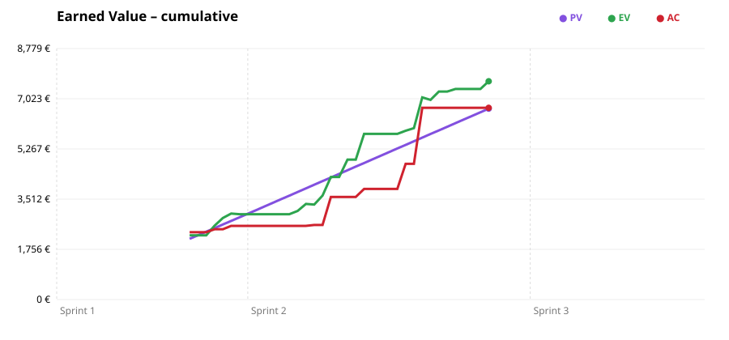

# Earned Value – HoDoWo

Status on **2026-11-18** (generated 2026-11-18 14:02 UTC).

| KPI | Name | Formula | Sprint 2 | Cumulative | Hours (cumulative) |
|---|---|---|---:|---:|---:|
| **PV** | Planned Value | % planned × BAC | 2,789 € | 5,663 € | 252.2 h |
| **EV** | Earned Value | % completed × BAC | 3,390 € | 6,489 € | 289.0 h |
| **AC** | Actual Cost | hours spent × rate + services | 1,970 € | 4,747 € | 231.7 h |
| **BAC** | Budget at Completion | Sprint 0 estimate (Sprint: its planned share) | 4,311 € | 9,879 € | 440.0 h |
| **EAC** | Estimate at Completion | BAC / CPI | 2,504 € | 7,227 € | 321.9 h |
| **ETC** | Estimate to Complete | EAC − AC | 535 € | 2,480 € | 90.2 h |
| **VAC** | Variance at Completion | BAC − EAC | 1,807 € | 2,652 € | 118.1 h |
| **CPI** | Cost Performance Index | EV / AC | 1.72 | 1.37 | – |
| **SPI** | Schedule Performance Index | EV / PV | 1.22 | 1.15 | – |

## Reading

- CPI 1.37: under budget (the completed work cost less than planned)
- SPI 1.15: ahead of or on schedule
- VAC 2,652 €: saving money
- Sprint 2: budget 4,311 € (its share of the BAC), EAC 2,504 € with the current CPI, so VAC 1,807 € (saving money).

## Inputs

- BAC: 9,879 € (total cost estimated in Sprint 0), 440 h planned for the whole project.
- % planned: 252.2 h of the Sprint 0 baseline by 2026-11-18 → 57.3%.
- % completed: 289.0 h estimated on the items in Done → 65.7%.
- AC: 231.7 h spent × 20 €/h + 113 € of services.
- Hypothetical costs: the team uses free tiers and pays nothing. Each service counts with the price planned in Sprint 0 from the date it is used.
- Not counted (outside Sprint 1, Sprint 2, Sprint 3): 15 items, 47 h estimated, 29 h spent.
  - #1 Create KanBan Board – Sprint 0 (2 h estimated, 2 h spent)
  - #15 Implement guide rating – no Sprint (4 h estimated, 0 h spent)
  - #25 Implement features and automations to kanban project – Sprint 0 (2 h estimated, 2 h spent)
  - #26 Point 7 of the document – Sprint 0 (3 h estimated, 3 h spent)
  - #27 Point 1 of 7 – Sprint 0 (3 h estimated, 3 h spent)
  - #28 Point 4 and 5 – Sprint 0 (3 h estimated, 3 h spent)
  - #29 Point 2 of 7 – Sprint 0 (3 h estimated, 3 h spent)
  - #30 Point 3 and 6 – Sprint 0 (3 h estimated, 3 h spent)
  - #31 Search technologies to use – Sprint 0 (2 h estimated, 2 h spent)
  - #35 Create base project on Android Studio – Sprint 0 (1 h estimated, 1 h spent)
  - #52 Manual reader UI – no Sprint (3 h estimated, 0 h spent)
  - #57 Guide step image display UI – no Sprint (3 h estimated, 3 h spent)
  - #60 AI Edit Image Step-by-step guide generator – no Sprint (5 h estimated, 4 h spent)
  - #69 Error code extraction from display photos – no Sprint (6 h estimated, 0 h spent)
  - #70 Error resolution card UI – no Sprint (4 h estimated, 0 h spent)

## Sprint 2 (2026-10-28 → 2026-11-24)

- Items: 39, estimated 186.0 h, completed 151.0 h, spent 97.0 h.
- Open items:
  - #13 Sprint 2 documentation – In Progress (4 h estimated, 0 h spent)
  - #111 Marketplace app screens – In Progress (0 h estimated, 0 h spent)
  - #29 Search ranking: partner sponsorship and personalisation – In preview (0 h estimated, 0 h spent)
  - #41 Partner tiers, sponsored ranking and 'for me' ordering – In preview (6 h estimated, 0 h spent)
  - #45 Marketplace end-to-end tests (API and device) – In preview (6 h estimated, 0 h spent)
  - #122 Mockups: marketplace, ads and cart pages – In preview (6 h estimated, 0 h spent)
  - #139 Product search page with new / second-hand / parts filters – Todo (9 h estimated, 0 h spent)
  - #144 Order confirmation and purchase history screens – Todo (4 h estimated, 0 h spent)

