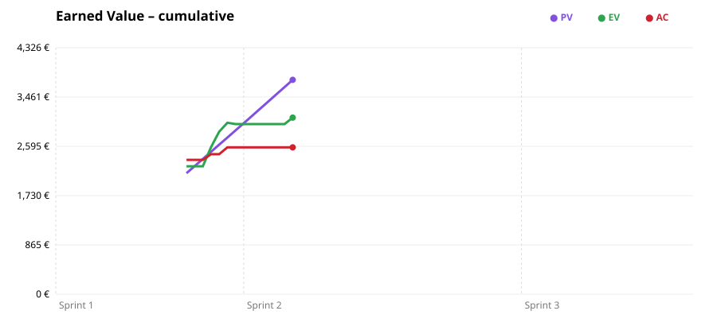

# Earned Value – HoDoWo

Status on **2026-11-12** (generated 2026-11-12 13:47 UTC).

| KPI | Name | Formula | Sprint 2 | Cumulative | Hours (cumulative) |
|---|---|---|---:|---:|---:|
| **PV** | Planned Value | % planned × BAC | 2,029 € | 4,903 € | 218.4 h |
| **EV** | Earned Value | % completed × BAC | 2,807 € | 5,793 € | 258.0 h |
| **AC** | Actual Cost | hours spent × rate + services | 1,290 € | 3,867 € | 187.7 h |
| **BAC** | Budget at Completion | Sprint 0 estimate (Sprint: its planned share) | 4,311 € | 9,879 € | 440.0 h |
| **EAC** | Estimate at Completion | BAC / CPI | 1,981 € | 6,595 € | 293.7 h |
| **ETC** | Estimate to Complete | EAC − AC | 691 € | 2,728 € | 106.0 h |
| **VAC** | Variance at Completion | BAC − EAC | 2,330 € | 3,284 € | 146.3 h |
| **CPI** | Cost Performance Index | EV / AC | 2.18 | 1.50 | – |
| **SPI** | Schedule Performance Index | EV / PV | 1.38 | 1.18 | – |

## Reading

- CPI 1.50: under budget (the completed work cost less than planned)
- SPI 1.18: ahead of or on schedule
- VAC 3,284 €: saving money
- Sprint 2: budget 4,311 € (its share of the BAC), EAC 1,981 € with the current CPI, so VAC 2,330 € (saving money).

## Inputs

- BAC: 9,879 € (total cost estimated in Sprint 0), 440 h planned for the whole project.
- % planned: 218.4 h of the Sprint 0 baseline by 2026-11-12 → 49.6%.
- % completed: 258.0 h estimated on the items in Done → 58.6%.
- AC: 187.7 h spent × 20 €/h + 113 € of services.
- Hypothetical costs: the team uses free tiers and pays nothing. Each service counts with the price planned in Sprint 0 from the date it is used.
- Not counted (outside Sprint 1, Sprint 2, Sprint 3): 15 items, 47 h estimated, 29 h spent.
  - #1 Create KanBan Board – Sprint 0 (2 h estimated, 2 h spent)
  - #15 Implement guide rating – no Sprint (4 h estimated, 0 h spent)
  - #25 Implement features and automations to kanban project – Sprint 0 (2 h estimated, 2 h spent)
  - #26 Point 7 of the document – Sprint 0 (3 h estimated, 3 h spent)
  - #27 Point 1 of 7 – Sprint 0 (3 h estimated, 3 h spent)
  - #28 Point 4 and 5 – Sprint 0 (3 h estimated, 3 h spent)
  - #29 Point 2 of 7 – Sprint 0 (3 h estimated, 3 h spent)
  - #30 Point 3 and 6 – Sprint 0 (3 h estimated, 3 h spent)
  - #31 Search technologies to use – Sprint 0 (2 h estimated, 2 h spent)
  - #35 Create base project on Android Studio – Sprint 0 (1 h estimated, 1 h spent)
  - #52 Manual reader UI – no Sprint (3 h estimated, 0 h spent)
  - #57 Guide step image display UI – no Sprint (3 h estimated, 3 h spent)
  - #60 AI Edit Image Step-by-step guide generator – no Sprint (5 h estimated, 4 h spent)
  - #69 Error code extraction from display photos – no Sprint (6 h estimated, 0 h spent)
  - #70 Error resolution card UI – no Sprint (4 h estimated, 0 h spent)

## Sprint 2 (2026-10-28 → 2026-11-24)

- Items: 39, estimated 186.0 h, completed 125.0 h, spent 63.0 h.
- Open items:
  - #25 Marketplace: data model and seed data – In Progress (0 h estimated, 0 h spent)
  - #26 Marketplace catalogue and search API – In Progress (0 h estimated, 0 h spent)
  - #32 Security rules for marketplace and forum collections – In Progress (3 h estimated, 0 h spent)
  - #111 Marketplace app screens – In Progress (0 h estimated, 0 h spent)
  - #27 Second-hand listings API – In preview (0 h estimated, 0 h spent)
  - #29 Search ranking: partner sponsorship and personalisation – In preview (0 h estimated, 0 h spent)
  - #37 Spare parts search and filter API – In preview (7 h estimated, 0 h spent)
  - #41 Partner tiers, sponsored ranking and 'for me' ordering – In preview (6 h estimated, 0 h spent)
  - #122 Mockups: marketplace, ads and cart pages – In preview (6 h estimated, 0 h spent)
  - #13 Sprint 2 documentation – Todo (4 h estimated, 0 h spent)
  - #30 Diagnosis to suggested spare part – Todo (5 h estimated, 0 h spent)
  - #34 Composite indexes for search and ranking – Todo (2 h estimated, 0 h spent)
  - #36 Listing image upload and compression – Todo (4 h estimated, 0 h spent)
  - #38 Part detail and compatibility resolution API – Todo (5 h estimated, 0 h spent)
  - #45 Marketplace end-to-end tests (API and device) – Todo (6 h estimated, 0 h spent)
  - #108 Parts catalogue and diagnosis link (app) – Todo (0 h estimated, 0 h spent)
  - #139 Product search page with new / second-hand / parts filters – Todo (9 h estimated, 0 h spent)
  - #144 Order confirmation and purchase history screens – Todo (4 h estimated, 0 h spent)

