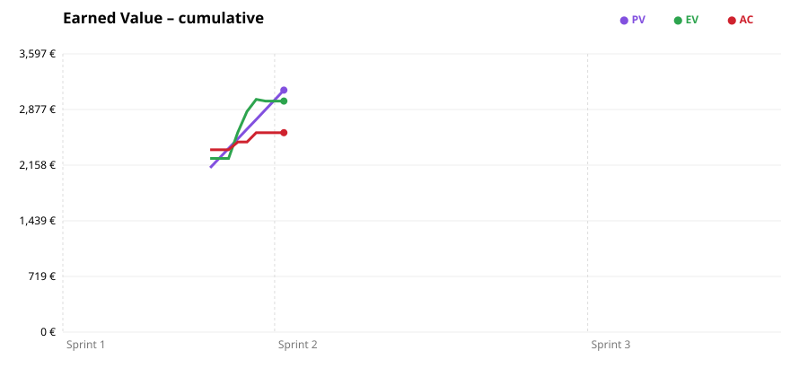

# Earned Value – HoDoWo

Status on **2026-10-23** (generated 2026-10-23 10:07 UTC).

| KPI | Name | Formula | Sprint 1 | Cumulative |
|---|---|---|---:|---:|
| **PV** | Planned Value | % planned × BAC | 2,374 € | 2,374 € |
| **EV** | Earned Value | % completed × BAC | 2,245 € | 2,245 € |
| **AC** | Actual Cost | hours spent × rate + services | 2,358 € | 2,358 € |
| **BAC** | Budget at Completion | Sprint 0 estimate (Sprint: its planned share) | 2,874 € | 9,879 € |
| **EAC** | Estimate at Completion | BAC / CPI | 3,018 € | 10,373 € |
| **ETC** | Estimate to Complete | EAC − AC | 660 € | 8,016 € |
| **VAC** | Variance at Completion | BAC − EAC | −144 € | −494 € |
| **CPI** | Cost Performance Index | EV / AC | 0.95 | 0.95 |
| **SPI** | Schedule Performance Index | EV / PV | 0.95 | 0.95 |

## Reading

- CPI 0.95: over budget (the completed work cost more than planned)
- SPI 0.95: behind schedule
- VAC −494 €: the project would end over the Sprint 0 budget
- Sprint 1: budget 2,874 € (its share of the BAC), EAC 3,018 € with the current CPI, so VAC −144 € (over the Sprint budget).

## Inputs

- BAC: 9,879 € (total cost estimated in Sprint 0), 440 h planned for the whole project.
- % planned: 105.7 h of the Sprint 0 baseline by 2026-10-23 → 24.0%.
- % completed: 100.0 h estimated on the items in Done → 22.7%.
- AC: 113.7 h spent × 20 €/h + 84 € of services.
- Hypothetical costs: the team uses free tiers and pays nothing. Each service counts with the price planned in Sprint 0 from the date it is used.
- Not counted (outside Sprint 1, Sprint 2, Sprint 3): 14 items, 43 h estimated, 29 h spent.
  - #1 Create KanBan Board – Sprint 0 (2 h estimated, 2 h spent)
  - #25 Implement features and automations to kanban project – Sprint 0 (2 h estimated, 2 h spent)
  - #26 Point 7 of the document – Sprint 0 (3 h estimated, 3 h spent)
  - #27 Point 1 of 7 – Sprint 0 (3 h estimated, 3 h spent)
  - #28 Point 4 and 5 – Sprint 0 (3 h estimated, 3 h spent)
  - #29 Point 2 of 7 – Sprint 0 (3 h estimated, 3 h spent)
  - #30 Point 3 and 6 – Sprint 0 (3 h estimated, 3 h spent)
  - #31 Search technologies to use – Sprint 0 (2 h estimated, 2 h spent)
  - #35 Create base project on Android Studio – Sprint 0 (1 h estimated, 1 h spent)
  - #52 Manual reader UI – no Sprint (3 h estimated, 0 h spent)
  - #57 Guide step image display UI – no Sprint (3 h estimated, 3 h spent)
  - #60 AI Edit Image Step-by-step guide generator – no Sprint (5 h estimated, 4 h spent)
  - #69 Error code extraction from display photos – no Sprint (6 h estimated, 0 h spent)
  - #70 Error resolution card UI – no Sprint (4 h estimated, 0 h spent)

## Sprint 1 (2026-10-06 → 2026-10-27)

- Items: 43, estimated 127.0 h, completed 100.0 h, spent 113.7 h.
- Open items:
  - #12 Create Project Documentation - Sprint 1 – In Progress (2 h estimated, 0 h spent)
  - #15 Implement guide rating – In Progress (4 h estimated, 0 h spent)
  - #37 Implement Favourites and Recent scanned Page – In Progress (0 h estimated, 0 h spent)
  - #54 Login, register and Google sign-in screens – In Progress (3 h estimated, 15 h spent)
  - #71 Plan Sprint 2 – In Progress (4 h estimated, 0 h spent)
  - #51 Auth and profile – Todo (12 h estimated, 0 h spent)
  - #56 Profile and saved appliances: Firestore schema + UI – Todo (2 h estimated, 0 h spent)

